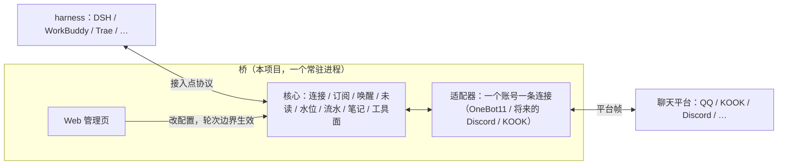
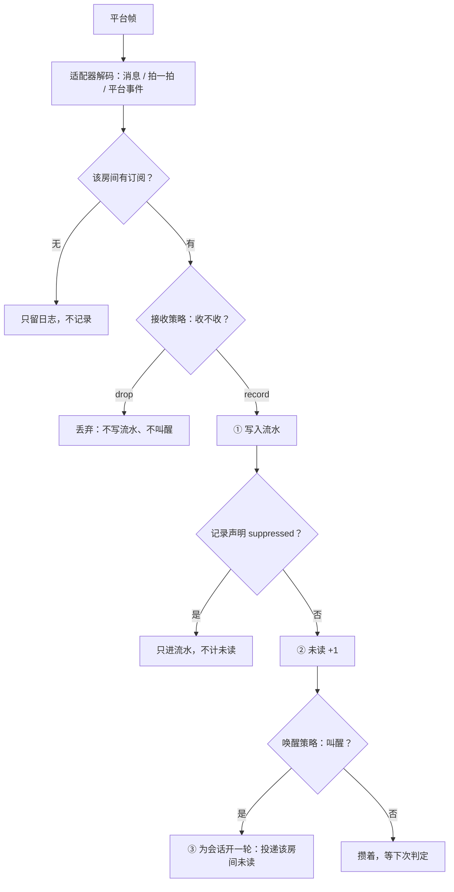
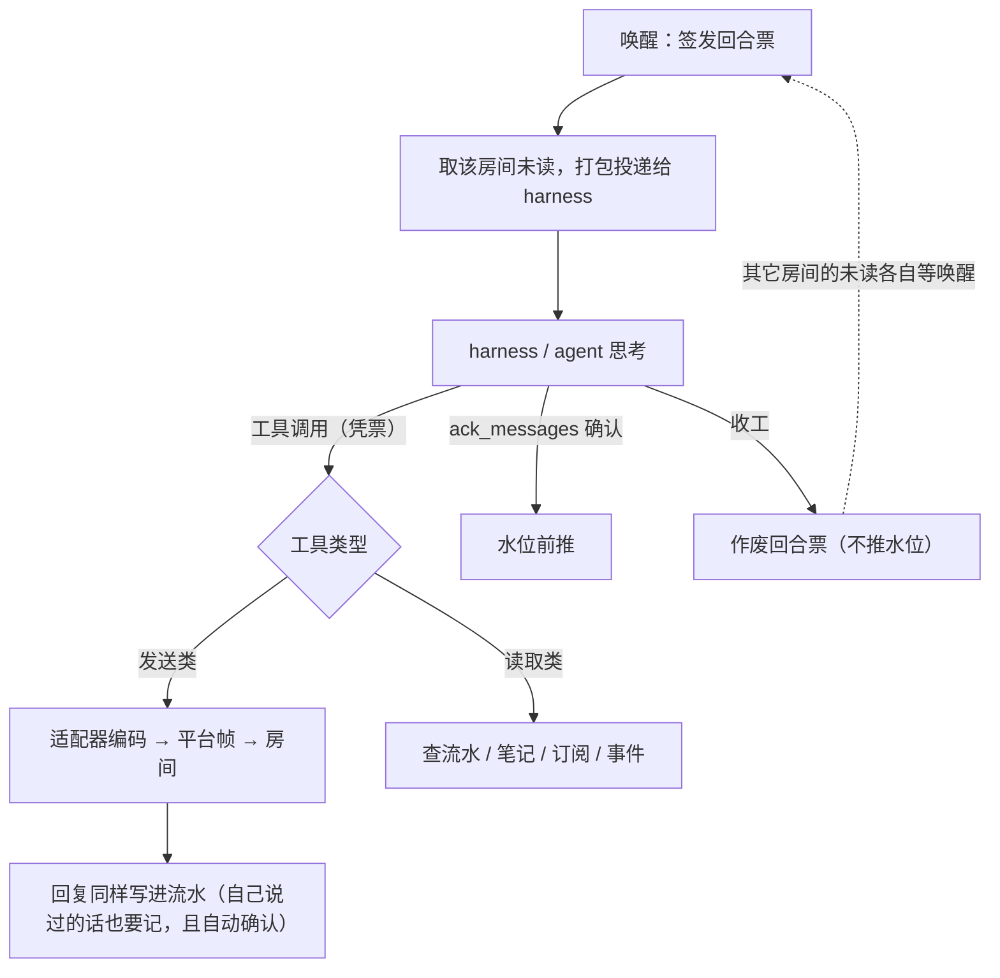

# 架构设计

> 状态：草稿，等用户过目。
> 术语全部遵循[术语表](02-glossary.md)。关键决定配了 ADR，每个 ADR 开头标来源。

## 一张图看懂



桥是一个常驻进程。上面接 harness，下面接聊天平台，中间是核心；管理员通过 Web 管理页改配置。

## 组件清单

| 组件 | 职责 | 对应 ADR |
|------|------|----------|
| **接入点** | harness 连进来的通道：本机套接字或 TCP + 接入令牌。harness 与桥说自己的协议，桥不关心 harness 内部 | [0008](adr/0008-harness-endpoint.md) |
| **回合调度** | 管理「轮次」的生命周期：叫醒 → 投递未读 → 等 harness 干活 → 收工具调用 → 回复 → 收工。同一会话的轮次严格串行（ADR-0017） | [0003](adr/0003-serial-turns.md) |
| **订阅表** | 会话订了哪条连接上的哪个房间、那条订阅的唤醒策略。收发的合法目标**默认**全部从这里查；会话的访问策略可以放宽（ADR-0026）。发送用哪把账号由连接决定，订阅不重复写 | [0002](adr/0002-subscription-model.md) |
| **策略机制** | 策略的载体：内置默认实现 + 用户自定义（Lua 脚本或动态库）；外置进程只承载平台适配器 | [0026](adr/0026-plugin-host.md) |
| **消息路由** | 入库前把命令/链接交给插件；`pass` / `drop` / `handle`，发送和后台任务在锁外执行 | [0028](adr/0028-message-routing.md) |
| **扩展宿主** | RootManager 固定；LoaderPlugin / ManagerPlugin 都是扩展点；Provider 按 id 选择 | [0026](adr/0026-plugin-host.md) |
| **时钟源** | 周期评估：房间空闲超时、未确认未读补投、主动说话的入口 | [0011](adr/0011-clock-policy.md) |
| **流水 / 未读 / 水位** | 流水按房间一份；水位与未读按订阅（会话 × 房间）各记一份，未读是两者相减。永久存储 | [0003](adr/0003-serial-turns.md) |
| **笔记** | 会话在单个房间里的速记事实，按房间隔离，跨连接不串 | [0003](adr/0003-serial-turns.md) |
| **工具面** | agent 能调用的全部工具：发送类 + 读取类。身份靠回合票 | [0006](adr/0006-tool-surface.md) |
| **适配器** | 一种平台协议的实现：解帧成事件、编动作成帧、内容元素双向转换 | [0004](adr/0004-content-elements.md) |
| **harness 适配器** | 桥外面那一半：把轮次变成 harness 里的一次对话，把工具挂进去。有插件 API 的走插件，没有的走进程外驱动或 MCP | [0013](adr/0013-harness-adapter-shape.md) |
| **Web 管理页** | 管理员改配置的唯一入口：订阅、策略参数、人格、账号。配置修改不进 agent 工具面 | [0009](adr/0009-config-management.md) |

## 两条数据流

### 入站（平台 → 会话）



要点：接收策略是入站第一道门，`drop` 的记录连流水都不进；进了流水之后，记录与唤醒分离
——唤醒策略只决定「开不开轮次」，永远不阻止记录（拍一拍同理，见
[ADR-0007](adr/0007-poke-as-message.md)）。`suppressed` 是记录自身属性：写进流水但永久
不进未读、不投递、不唤醒。

### 轮次（会话干活）



要点：收工**不**推水位——没确认的消息下一轮重投（[ADR-0010](adr/0010-ack-watermark.md)）。图表里那一句「推水位」是确认动作的结果，不是收工的结果。

## 存储形态

来源：SQLite 为用户裁定；表结构、路径默认、版本检查为实现默认。详见 [ADR-0014](adr/0014-state-on-disk.md)。

单文件 SQLite 存流水、水位、笔记、投递次数。理由：这几样都是「按房间追加 + 按游标读」的形状，SQLite 一个文件就够，备份就是拷文件；换存储引擎只动一层接口（`Store` 那一组 trait）。

未读**不单独存**，是流水里水位之后的部分——算出来的，不会出现两套账对不上。几样的粒度不一样：流水按房间，水位与投递次数按「会话 + 房间」（投递次数还带记录编号），笔记按房间。

**票和排队不落盘**：它们是一次性的，重启后由新的入站唤醒重新生成。所以重启不会「接着跑半截轮次」，而是干净地等下一次唤醒。

库里带着结构版本号（`meta.schema_version`）。老库打开时就地升级（补列、建索引），比程序新的库**拒绝打开**——不往认不识的结构里写数据。改表必须先写迁移。

流水有**保留策略**（[ADR-0015](adr/0015-retention.md)）：按条数和天数两个上限删旧记录，但只削「所有在册订阅者都已读到」的那一段。未读是投递的原料，一条都不碰。

细节（每张表干什么、清理规则、怎么查、怎么备份）见 [07-storage.md](07-storage.md)。

## 配置管理

来源：用户裁定，细节为实现默认。详见 [ADR-0009](adr/0009-config-management.md)。

- 配置修改**不进 agent 工具面**——agent 不能改自己的权限边界。
- 管理员通过桥自带的 **Web 管理页**改配置（独立进程放不了别人的配置界面，必须自带）。
- 改完不立即生效：**轮次边界重载**——正在跑的轮次用旧配置跑完，下一轮开始时用新配置。轮次本来就是天然切换点，不需要担心「订阅改到一半」的边界情况。

## 进程与并发模型

来源：实现默认，可以随时推翻。

单进程。每个外部连接（平台连接、harness 连接）一个线程，另加一个 HTTP 线程服务 Web 管理页。会话之间并发，同一会话内部串行（由回合队列保证；串行键 = 会话 id，配置里全局唯一，串行单位 = harness × 会话，记忆不是锁）。不引入异步运行时——旧实现验证过阻塞模型在这个规模下够用。

## 三个待决问题的实现默认答复

用户未具体拍板，先按下面做，随时可推翻：

1. **唤醒的其它条件**（关键词、免打扰名单、睡眠时段）：做成默认唤醒策略的**可选开关**，默认全关。默认策略本身保持「@ + 昵称 + 攒 N 条」三件套。
2. **读取类工具第一版范围**：全做——`get_history` / `list_rooms` / `get_notes` / `set_note` / `del_note` / `get_platform_events`。每个工具都很薄，成本主要在协议层，一次做齐省得反复改。之后又补了 `fetch_records` / `platform_methods` / `platform_call` / `describe_plugins` / `report_feedback` / `memory_*`，当前清单见[术语表](02-glossary.md#工具面)。
3. **标准元素表**：第一版就 8 个（text / at / quote / image / audio / video / file / 表情），不加 markdown。平台富文本走不透明载荷透传；等真有跨平台富文本需求再加元素，加元素是兼容演进。

## 目录规划

```
crates/
  proto/                 桥 ↔ harness 的协议（帧、内容元素、记录、回合票）
  adapter-api/           适配器 wire / C ABI，进程与动态库共用
  kernel/                核心：订阅、唤醒、流水、水位、笔记、回合调度、工具面、接入点
    src/storage.rs         存储接口 + 内存实现
    src/storage/sqlite.rs  落盘实现（正式跑用这个）
  adapters/onebot11/     OneBot 11 适配器（QQ 群与私聊）
  adapters/process/      外置进程载体（stdin/stdout JSON，崩溃隔离）
  adapters/dynamic/      动态库载体（libloading，进程内）
  plugins/lua/           Lua manager/loader：每文件一个 provider
  plugins/trusted/       树外 native manager 示例（trusted.accumulate_only）
  bridge/                可执行程序：读配置、连平台、起接入点、起控制台
    src/main.rs          桥本体
    src/bin/dev-harness  开发用的最小 harness（验「桥 ↔ 平台」这一段）
harnesses/
  opencode/
    plugin/             v2 插件目录：index.js（工具面 + 轮次驱动）+ acb-wire.mjs（协议客户端）
    probe.mjs           不用 opencode 也能验「桥这一段」的探针
    test/               协议层 28 + 插件逻辑 11
  dsh/                  进程外驱动：MCP server + webui HTTP/WS 客户端
  shared/tools.mjs      两个 harness 共用的工具名/描述/JSON Schema
examples/
  lua/                  七种策略的可运行 Lua 示例
  process/              外置进程适配器的最小 Node 实现
  dynamic/wake-provider 可独立构建的动态库策略示例
docs/
  01-vision.md       愿景与范围
  02-glossary.md     术语表
  03-architecture.md 本文
  04-protocol.md     桥 ↔ harness 的协议细节
  05-adapters.md     平台适配器：房间写法、事件与元素映射、已知限制
  06-harness-adapters.md harness 适配器：工具面与轮次驱动两半，各家怎么接
  07-storage.md      状态库：每张表干什么、怎么查、怎么备份
  08-plugin-development.md 插件开发：载体、扩展点、wire 字段、测试
  adr/               决策记录（每条标来源）
```

## 文档书写约定

全库文档**禁用字符画**：图一律用 mermaid（AI、GitHub、多数渲染器都能读）；表格用 Markdown 表格。
