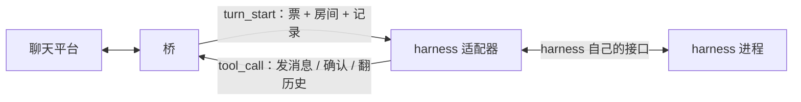

# 06 · harness 适配器

> 状态：opencode v2 插件、dsh 驱动都已真机跑通（2026-10-31 / 11-02 复验）；opencode 当前
> 用 `opencode2 serve` 常驻（见下面「常驻部署」）。WorkBuddy 与 LobsterAI 的**协议层**
> 已实现并通过本地 mock（2026-11-06）：WorkBuddy 另用真实 headless CLI 做了未登录探测，
> 真实登录/额度下的整轮仍未验证；Trae 本轮明确放弃。早期 2.0.22 的插件加载问题记在文末，
> 作为历史记录保留。
> 原则：桥不懂 harness 的内脏，harness 也不懂平台细节。适配器是那个翻译。

## 一个适配器要干两件事

这两件事互不依赖，可以分别做到、分别缺席：

1. **工具面**：让模型看见桥的一整套工具（发消息、确认水位、翻历史、记笔记、平台能力……），
   模型一调，就原样变成一帧 `tool_call` 发给桥。
2. **轮次驱动**：桥推来一轮（`turn_start`，带着这个房间的未读记录），把它变成 harness 里
   的一次对话，跑完回 `turn_end`。



只有工具面、没有轮次驱动的，叫**半接**：能发不能收，桥推过来的活没人干。这种事要在
文档里写清楚，不能让人以为接完了。

轮次驱动还负责把桥下发的**语义数据**翻译成 harness 自己的上下文：`records` 是这一轮要处理的消息，`memories` 是记忆 worktree，`session_info` 是身份和模型，`persona` 是人格卡正文。桥只给语义，不规定格式——适配器决定 persona 是塞 system prompt、首轮 context 消息，还是每轮开头的一段说明。模型变更、tool update 这类 **harness 内部**上下文由 harness 自己生成，桥不掺和。

## 两半各有各的手段

| 能力 | 手段 | 需要 harness 有 | 代价 |
|------|------|-----------------|------|
| 工具面 | 插件里注册自定义工具 | 插件 / 扩展 API | 跟 harness 版本绑得紧 |
| 工具面 | 挂一个 MCP server | 支持 MCP（多数都有） | 多一层进程，桥要额外实现 MCP |
| 轮次驱动 | 进程内：插件里起后台循环，反调会话接口注入一条消息，等它回完 | 插件 API，且能反向驱动会话 | 可能和 harness 自己的事件派发打架 |
| 轮次驱动 | 进程外：桥旁边跑个小程序，用无头模式 / HTTP / CLI 驱动 | 无头模式或服务端 API | 慢；会话续接、结束判定都要自己猜 |

结论：**有插件 API 就走插件**，工具面和轮次驱动都在同一个进程里，最跟手；没有插件
API 才退到进程外驱动或 MCP。这条判断写进了 [ADR-0013](adr/0013-harness-adapter-shape.md)。

## 拿到一个新 harness，先问四句

1. 能不能注册自定义工具？（决定工具面走插件还是 MCP）
2. 能不能从扩展点里反过来驱动一次会话，并且知道它什么时候结束？（决定轮次驱动走进程内还是进程外）
3. 没有插件的话，有没有服务端 / 无头模式？能不能接着上一次的会话继续？
4. 上面都不行？那就只挂 MCP，算半接，文档里标明「只能发不能收」。

## 当前各家的情况

下面「判断」一栏里，只有 opencode 和 dsh 是**真跑通过**的；其余是**待核实**，别当结论用。

| harness | 扩展点 | 轮次驱动 | 判断 |
|---------|--------|----------|------|
| opencode | 插件（v2：`export default { id, setup(ctx) }`；工具用 `ctx.tool.transform` 注册，模型经 `execute` 调 `tools.X`） | 进程内：`ctx.session.prompt` 排话 + `ctx.session.wait` 等它说完 | 插件型，见 `harnesses/opencode/plugin/`；真机整轮已验（私聊 + 群）；2026-10-31 在 opencode2 2.0.22 上复验：插件加载正常、模型一次答全 25 个工具名 |
| DSH | MCP（`dsh-mcp-client`，工具名 `mcp__acb__*`） | 进程外：驱动器调 webui HTTP/WS API（`session/prompt` + `session/follow` 等 `turn/end`） | 进程外 + MCP，见 `harnesses/dsh/`；协议层真机已验，模型真回话待配模型 |
| WorkBuddy | CLI（headless bundle；`--mcp-config` + `--strict-mcp-config`） | 进程外：每轮 spawn `codebuddy-headless.js -p … --output-format stream-json`，`result` 事件/进程退出即结束 | 进程外 + MCP，见 `harnesses/workbuddy/`；协议层已验（18 个用例 + 真实 CLI 未登录探测），模型真回话待登录 |
| LobsterAI | MCP（OpenClaw `mcp.servers`，streamable-http） | 进程外：WS 连 LobsterAI 内置 gateway，`chat.send` + `agent.wait` | 进程外 + MCP，见 `harnesses/lobsterai/`；假 gateway 协议层已验（16 个用例），真实 app/gateway 待启动 |
| Trae | — | — | 本轮放弃（可行性文档 3.8 的 spike 已经证明稳定 API 没有轮次完成信号） |
| Codex | 无插件；有 `codex exec` 这类无头入口 | 进程外：每轮起一次 | 大概率进程外 + MCP 补工具面 |
| OpenClaw | 由 LobsterAI 适配器覆盖（`mcp.servers`） | 进程外：`chat.send` + `agent.wait` | 不单独做通用 OpenClaw；本轮只做 LobsterAI 自己的 gateway/state |

## opencode 这一份怎么用

opencode 有 v1 和 v2 两套插件 API，**写法不通用**。我们按 v2 写（本机能装到的是 v2）。

v2 的插件是一个目录：`index.js` 是入口，`acb-wire.mjs` 是协议客户端（入口 import 它）。

**不拷贝，直接指向本仓库的这个目录。** 本机根目录是 tmpfs，只有仓库是可靠的持久位置；
拷到 `~/.config/opencode/plugins/` 的东西哪天就没了。配置文件里写绝对路径即可：

```jsonc
// 全局 ~/.config/opencode/opencode.json，或某个项目根的 opencode.jsonc
{
  "plugins": [
    {
      "package": "/path/to/agent-chat-bridge/harnesses/opencode/plugin",
      "options": { "token": "接入令牌" }
    }
  ]
}
```

完整可抄的版本在 [`harnesses/opencode/opencode.jsonc.example`](https://github.com/DataEraserC/AgentChatBridge/blob/dev_20261025/harnesses/opencode/opencode.jsonc.example)。

也可以用环境变量，选项优先于环境变量：

```bash
export ACB_TOKEN=<接入令牌>         # 和 config.toml 里会话的 token 一致
export ACB_ENDPOINT=127.0.0.1:7700  # 可选，默认就是这个
```

没给令牌时插件直接不启用，只写一条警告——不阻塞 opencode 启动。

### 常驻部署：`opencode2 serve`（默认）

用 systemd 托管一个前台 `opencode2 serve`，不要靠 `opencode2 run` 反复踢：

- [`deploy/opencode-serve.sh`](https://github.com/DataEraserC/AgentChatBridge/blob/dev_20261025/deploy/opencode-serve.sh) 起 serve（默认 `127.0.0.1:4097`），
  等 `/api/info` 通；
- 然后 `GET /api/plugin?location[directory]=<项目目录>` 让这个 location 初始化——插件在
  这一步加载并连桥，**不需要模型请求**；
- [`deploy/systemd/acb-opencode-serve.service`](https://github.com/DataEraserC/AgentChatBridge/blob/dev_20261025/deploy/systemd/acb-opencode-serve.service)
  负责常驻，serve 日志写 `state/logs/opencode-serve.log`；
- 旧的 `acb-opencode-keeper.service`（`opencode2 run` 踢一脚）保留在仓库里，但不再启用。

为什么不靠 `opencode2 run`：它加载的插件只在 run 存活期间有效，run 退出连接就断；keeper 只能
反复踢，既没有常驻保证，每次还要烧一次模型请求。`opencode2 serve` 是真正的常驻 HTTP 服务。

注意：插件在 **location 初始化之后**才加载。单纯 `POST /api/session` 不会触发，
`GET /api/plugin` 或第一次 `prompt` 才会；服务脚本用前者完成自检。

改了插件代码后：`systemctl --user restart acb-opencode-serve`；serve 起来之后也可以
`POST /api/location/reload` 热重载插件（会先卸载再加载，桥上的连接会短暂断开一次）。

几个刻意的做法：

- **一个 acb 会话一份 opencode 会话**，标题 `acb:<会话 id>`。会话 id 记在插件自己的 storage 里，
  重开接上，找不到才新建；每次用前确认它还活着（用户在 TUI 里删了会话也能自愈）。
  一个 acb 会话订两个房间时，两个房间共享同一份 opencode 上下文——这是「同一会话管多个群」
  的代价，回复的默认房间由当前轮次的票决定，不会因为上下文里有别的群就发错。
- **`prompt` 排话、`wait` 等它说完**，两个连起来才是一轮。v2 的 `prompt` 只保证把话排进
  会话，模型随后才跑；只看 `prompt` 返回就收工，会把票提前作废，工具调用全成
  `unauthorized`（假宿主测试里踩过这个）。
- **同一连接的多个轮次必须串行**。桥允许一条 harness 连接同时跑多个 acb 会话（ADR-0019），
  但工具调用只认「当前这一轮的票」。插件把 `turn_start` 排进队列，`endTurn` 之后才换下一张票；
  不这样的话，后到的轮次会覆盖正在跑的票，工具调用就可能把话发到另一个房间（真实踩过的
  「串群」就是这么来的）。
- **工具只在轮次内可用**。没有票的调用一律 `unauthorized`。这样人在 TUI 里手动跟同一个实例
  聊天，也不会把话发到别人的房间里。
- **失败也回 `turn_end`**。`prompt` 抛错、会话被删、连接断了，都带着错误收工——桥靠
  `turn_end` 或断连释放会话，不回就一直占着。
- **断线自己重连**，退避 1 秒起、最长 10 秒。桥比 opencode 晚启动也能接上。

### 没有 web 时怎么看它在干什么

opencode 不像 dsh 有界面。插件选项里配了 `logFile` 之后（示例见
[`opencode.jsonc.example`](https://github.com/DataEraserC/AgentChatBridge/blob/dev_20261025/harnesses/opencode/opencode.jsonc.example)），
它会把这些动作逐行追加进去：

```bash
tail -f state/logs/opencode-plugin.log
```

```
2026-11-02T03:31:02Z info 插件加载 endpoint=127.0.0.1:7700 …
2026-11-02T03:31:02Z info 已接入桥，绑定会话组 opencode-1093015329、opencode-1124995534
2026-11-02T03:31:02Z info turn_start a-1 会话 … 房间 qq:group/…（队列 1）
2026-11-02T03:31:02Z info 开轮 …：qq:group/…，3 条，opencode 会话 ses_…，模型 …
2026-11-02T03:31:03Z info prompt 已发出 …，等待模型
2026-11-02T03:31:09Z info 本轮完成 …，用时 6.2 秒，调用桥工具 2 次
2026-11-02T03:31:09Z info turn_end …
```

看到「prompt 已发出」但很久没有「本轮完成」，就是模型还在跑；看到「本轮完成，
调用桥工具 0 次」则是模型没说任何话（可能是会话坏了，控制台重置一下映射）。
失败会直接写 `error` 行，带原因和耗时。

### 写 v2 插件绕不过去的几个坑（都是实测）

| 现象 | 原因 / 做法 |
|------|-------------|
| 插件放进去没反应，日志里连「loading plugin」都没有 | `.opencode/plugins/` 只自动发现**直接的 `.js` / `.ts` 文件**和**插件目录**；`.mjs` 文件不认。入口用 `index.js` |
| `Cannot find package '@opencode/plugin'` | 本地插件不自动带这个包。不用它就行：直接 `export default { id, setup }`，功能一样（`Plugin.define` 只是语法糖） |
| 插件一加载，opencode 报 `Transport: The socket connection was closed unexpectedly` | 插件里 `console.log` 写到了 **stdout**，而 `serve --stdio` 用 stdout 当 RPC 通道，协议被污染。日志只能走 `ctx.app.log` 或 `console.error` |
| 插件明明连上了，日志里却一个字都没有，查不到「已接入桥」 | 实测 2.0.22 在 `serve --stdio` 下 `ctx.app.log` **不落盘**（`~/.local/share/opencode/log/opencode.log` 里搜不到任何 `service=` 的行）。插件现在**同时**写 `console.error`（stderr 安全，stdout 不行）和插件选项里的 `logFile`；后一个就是没有 web 时看「它到底在干什么」的窗口 |
| 模型照你说的直呼 `send_message`，报 `No tool named "send_message" is currently available` | v2 里插件注册的工具进的是「Code Mode」目录，**不在**模型的原生工具表里；必须用 `execute` 跑一行 JS：`await tools.send_message({ text: "…" })`。插件现在会在投递末尾附这条提示，免得模型白失败一次 |
| 配置写 `"plugin": ["./acb.js"]` 报 `configured plugin path must be a directory` | v2 的键叫 `plugins`（复数），且本地路径必须是**目录**，指向单个文件会被跳过 |
| 模型能绕过桥直接 `fetch` 平台端口：不校验订阅、不记水位、不进归档，桥一声不知道 | `execute` 的运行时**提供 `fetch`**（官方原文 "It provides fetch for HTTP requests"）——这是 Code Mode 的设计，不是漏配。桥在另一个进程，拦不住。做法：投递末尾把 `platform_methods` / `platform_call` 指给它，并说清绕过去之后「消息不归档，下一轮对这段对话就失忆」。真要堵死只能走网络层（平台端口只监听本机 / 配 access_token）或 harness 侧权限规则。**已实测（2026-10-31，opencode2 2.0.22）**：execute 里 `fetch("http://127.0.0.1:4097/")` 返回 `200\|<!doctype html>`，本机端口随便敲；敲 53000 拿到 `unauthorized`（401），说明连得通、只是缺 token |

## 怎么验

四层，越往下越真：

```bash
# 1. 协议层：假桥，验握手 / 开轮 / 工具配对 / 错误码 / 渲染（28 个）
node --test harnesses/opencode/test/wire.test.mjs

# 2. 插件逻辑：假桥 + 模拟的 v2 宿主，验工具注册 / 一轮的完整动作 / 会话复用 / 卸载（11 个）
node --test harnesses/opencode/test/plugin.test.mjs

# 3. 对着真桥（不用 opencode）：握手成不成
node harnesses/opencode/probe.mjs --token <接入令牌>

# 4. 真链路：真 opencode + 真桥 + 真 QQ，模型真的回话（已验，见下）

# 5. LobsterAI 协议层：假桥 + 假 gateway（16 个）
node --test harnesses/lobsterai/test/*.test.mjs

# 6. WorkBuddy 协议层：假桥 + 假 headless CLI（18 个）
node --test harnesses/workbuddy/test/*.test.mjs
```

第 3 步里 `probe.mjs` 会把投递的内容打出来、回一句话、确认水位。它和插件用的是同一个
协议客户端，所以这里看得到的，插件也看得到——区别只在「交给谁去思考」。

### 没有 TUI 时怎么驱动它（2026-10-31 摸出来的）

在 AI 会话/脚本里跑不了交互界面，这两条路都不通，别浪费时间：

- `opencode2 run --standalone`：卡死在内部的 `serve --stdio`，日志只到「spawning process」，
  然后一直没输出（两次实测，100 秒零进展）。
- `opencode2 service start` + `run`：服务进程在会话沙箱里起不来，CLI 报
  `Transport: Unable to connect`——就是老问题，常驻进程不能挂在会话里。

能走通的是让 systemd 托管一个 HTTP 服务，再用 API 驱动：

```bash
# 1. 后台起服务（脱离会话沙箱；WorkingDirectory 必须是放了 opencode.json 的目录）
systemd-run --user --unit=oc-test --collect \
  -p WorkingDirectory=/home/nixos/qqab-scratch/oc-live \
  --setenv=OPENCODE_PASSWORD=<自己定一个> \
  /bin/sh -c 'env -u HTTP_PROXY -u HTTPS_PROXY NODE_EXTRA_CA_CERTS=$PWD/ca.pem \
    opencode2 serve --hostname 127.0.0.1 --port 4097'

# 2. 建会话 → 发话 → 读回复（全部 basic auth，用户名随便写）
curl -u "opencode:<密码>" -H 'Content-Type: application/json' \
  -X POST http://127.0.0.1:4097/api/session -d '{}'
curl -u "opencode:<密码>" -H 'Content-Type: application/json' \
  -X POST http://127.0.0.1:4097/api/session/<会话id>/prompt -d '{"text":"…"}'
curl -u "opencode:<密码>" http://127.0.0.1:4097/api/session/<会话id>/message

# 3. 收工
systemctl --user stop oc-test
```

`prompt` 是**异步**的：调用只把话排进去，回复要过几秒再拉 `/message` 才有。消息列表里
`type=assistant` 的 `content[]` 才是模型说的话，`type=reasoning` 是它的思考，`type=tool` 是
工具调用（带 `state.status`，卡在 `running` 就是没人批准权限）。

## 实测进度（2026-10-29）

**加载 → setup → 握手 → 绑定会话组，四步都验过了。** 启动方式：

```bash
# 项目根的 opencode.jsonc 里 plugins 指向本仓库的 plugin 目录（见 opencode.jsonc.example）
opencode2 --standalone
```

看到这两样就算接上了：

```
[acb] info 已接入桥，绑定会话组 main
```
```
ESTAB 127.0.0.1:7700   127.0.0.1:44758  users:(("acb-bridge",pid=17401,fd=7))
ESTAB 127.0.0.1:44758  127.0.0.1:7700   users:((".opencode2-wrap",pid=169923,fd=26))
```

昨晚 `opencode2 2.0.22` 加载任何插件都 `panic: Segmentation fault`（4 行空插件同样崩），
今天同一台机器同一版本**不复现**。那一关过去了。

## 整轮：验过了（2026-10-29，私聊和群都跑了）

链路全通，私聊和群各一轮：

```
真 QQ 发「在吗」
  → 桥归档 #3、开轮（票 main-1）
  → 插件渲染投递 → opencode 会话 acb:main
  → 模型用 execute 调 await tools.send_message({text:"你好！我在。…"})
  → 桥 → OneBot → QQ 里真收到了
  → 模型再调 await tools.ack_messages({ids:[…]})
  → 水位推到 7，下一轮不再重投
```

群里那一轮（`@机器人 你是什么模型？`）同样走通，回答落在群里，不是私聊。
另外重启 opencode 之后会打 `接上会话 ses_…（acb:main-memory）`——**会话就是记忆，重启接得上**。

### 模型这一环，踩过的坑

- `opencode2` 自带的免费额度被限流（`Free usage limit reached`）。
- 全局配置里的 `agentrouter-openai` 要 `AGENTROUTER_API_KEY`，本机没这个变量，报 `未提供令牌`。
- `1AgentRouter/gpt-6.1-sol` 这类 key 本身没问题：直接 curl `localhost:1100` 的
  `/v1/chat/completions`、`/v1/responses`、`/v1/messages` 三条路都能出字。当时接进 opencode
  一律报 `model '…' not found`，一度以为是「只认 models.dev 目录」——**那个判断是错的**，
  真因见下面「换成 1AgentRouter」一节。
- 最后用本机 openrouter key + 免费模型 `nvidia/nemotron-3-ultra-550b-a55b:free` 跑通。
  另外 `liquid/lfm-2.5-2.6b:free` 也能接上，但它只会写思考、`finish=stop`，不肯调工具——
  模型太小的时候，链路没错也会看着像坏。
- **免费额度是按天的，会真的用完。** 2026-10-29 中午 11:35，一个 24 人、每分钟三四条的群
  加进来，攒条数设的 5：十分钟里开了 7 轮，每轮把整堆未读（20~35 条）塞给模型，免费额度
  （没充过值的账号 50 次/天）当场见底，报 `Rate limit exceeded: free-models-per-day`。
  从那以后**所有房间都不回**了，包括私聊——额度是账号级的，不按房间分。
  教训有两条：热闹群的攒条数别设小（现在设 200，等于只认 @/名字/拍一拍）；
  以及「不回」先看模型额度，别急着怀疑桥。
- **dsh 的模型是「会话级」记着的，改默认模型不会改老会话**。会话记录里有
  `modelSelection.lastUsed`，复用老会话时它优先于 `agent-default-model`（那个只管新建会话）。
  所以换模型后老会话会一声不响继续打旧渠道——桥这边不报错，只有看上游网关的日志才发现
  请求还在打旧模型。现在驱动每轮开始前会 `session/selectModel` 钉一次（`TurnDriver#pinModel`），
  模型值由 `deploy/start-drivers.sh` 从 `dsh-mcp.patch.yml` 的 `agent-default-model` 读出来传进去。

## 重启桥的代价：正在跑的那一轮作废（来源：实现默认）

票只活在桥的内存里，桥一重启就没了。插件那边不知道，会把这一轮老老实实跑完，然后：

- `turn_end` 被桥回一句 `收到了不属于当前轮次的 turn_end，已忽略`（插件记成一条 warn）；
- 模型如果在轮次中间调工具，拿到的是 `unauthorized`——票已经不是它的了。

只有「改配置、换二进制」这种手动重启会撞上；日常断线重连不受影响（票本来就是每轮现发的）。
要彻底消掉，得把票落盘，或者桥关的时候主动告诉在跑的轮次「作废吧，别白想」——没做，
等真被烦到再说。

## 已知没验的地方

- 内容段参数用宽松的 `items: { type: "object" }` 接，靠描述文字教模型写元素。宁松勿严：
  写错了桥那边会给出比 JSON Schema 更准的话。
- `ctx.session.create` 的返回形状按文档写（`id`），另外兼容 `sessionID` / `session.id` /
  `data.id` 三种老形状；opencode 换版本改形状时，这里要跟着看。
- 插件文件改动后 opencode 的 watcher 会热重载（日志里会再出现一次 `已接入桥`），旧连接自动断。
  这个行为没写进任何文档，属于实测观察。
- ~~Code Mode 的目录预算是 2000 token，acb 的 25 个工具塞不塞得下没量过~~ → **已验（2026-10-31，当时 25 个）**：
  实测让模型「把这类工具名全部列出来」，它一次列了 25 个、一个不差（`send_message` … `notes`，当时笔记还是三个工具）。
  目录装得下，不用靠 `$codemode.search` 兜。之后又加了记忆工具、`wait_message` 和 `capabilities`，当前工具面是 29 个。
- **原生工具调用要过权限**（实测）：让模型用原生 `read` 读 `config.toml`，工具停在 `status: "running"`、
  没执行——`serve` 模式没人批准就不动。但 `execute` 里的 `fetch` **不受这道门管**（它不是工具）。
  所以「读 token」这一步有阻力，「用 token 敲端口」这一步没有。开 `--auto` 时前者也没了。

## 换成 1AgentRouter：卡住的两个真坑（2026-10-29 下午）

想让会话走 `1AgentRouter/gpt-5.6-sol`（本机 `localhost:1100` 的中转），折腾一上午没成，
下午找出来是**两个和模型本身无关的原因**。

### 坑一：opencode 只接受 https 的 baseURL（来源：实测）

同一条 provider 配置，只改地址，结果两样：

| baseURL | 结果 |
|---|---|
| `https://ps.air-outer.com/v1` | 请求真的发出去了（回 401，说明模型已认） |
| `http://127.0.0.1:1100/v1`、`http://localhost:1100/v1`、任何 http | `model '…' not found` |

「模型不存在」是假象——http 地址进去以后，这个 provider 下的模型根本不会被列出来，
于是最先报的是模型找不到，而不是连不上。所以**别信这条报错**，先看 scheme。

本机的 1100 网关是 http，没法直接改，于是在中间垫一层 TLS 反代：

```
opencode ──https──> 127.0.0.1:11443（自签证书，字节透传，SSE 可用）──http──> 127.0.0.1:1100
```

脚本在 `~/qqab-scratch/oc-live/tls_proxy.py`（自带证书、日志、路径跟着脚本走），
opencode 那边要带 `NODE_EXTRA_CA_CERTS=<ca.pem>`，模型条目里写 `output` 上限。

### 坑二：会话钉在「它出生的那个目录」，换目录不换配置（来源：实测）

opencode 的模型是**按会话所在目录**去解配置的，不是按你启动时的 cwd。
`acb:main` 这条会话是在 `/tmp/oc6` 生的，于是不管从哪个目录启动、全局配置写什么，
它都回去读 `/tmp/oc6/opencode.jsonc`——那里还写着 openrouter 的 nemotron，
所以现象是「配置明明改了，还在报 openrouter 额度用完」。

改法（改一次就够）：把这条会话挪到常驻目录，两处表都要改：

```sql
update session_v2 set project_id='<新项目的 id>', directory='/home/nixos/qqab-scratch/oc-live'
  where id='ses_…';
```

（`project_id` 必须是 `project` 表里完整那个 40 位 id，别用打印出来的前缀。）

### 顺手确认的两件事

- **余额是按 `max_tokens` 预扣的。** 余额只剩 ¥0.02 时，opencode 按模型默认上限要输出 token，
  预扣 ¥0.03 直接被拒：`预扣费额度失败, 用户剩余额度…`。给模型条目加 `limit.output: 4096`
  后预扣降到额度内，请求立刻 200。这个值不能太小：一轮要带思考 + 一次 `execute` 调用，
  1024 容易截断；4096 实测够用。
- **改完怎么确认真的换过来了**：不看 TUI 状态栏，直接看会话里最新一条 assistant 记录的
  `model` 字段和 `finish`——`{"id":"1AgentRouter/gpt-5.6-sol","providerID":"arc"}` + `stop`
  才算成。

## 常驻的一套怎么起（2026-10-29）

> 这一节是当时的手工摸索记录；**当前默认常驻方式见前面的「`opencode2 serve`」**，
> 不用 `--standalone`，也不需要 TLS 反代。

三个进程，缺一个都不通。放在 `~/qqab-scratch/oc-live/`（NixOS 的 `/tmp` 是 tmpfs，不放那儿）：

```bash
# 1. TLS 反代（opencode → 1100 的中间层）
python3 ~/qqab-scratch/oc-live/tls_proxy.py

# 2. 桥（跑在仓库根，配置 config.toml）
cd <仓库根> && ./target/debug/acb-bridge --config config.toml

# 3. opencode：必须 --standalone（否则插件找不到入口），必须走 pty（否则 TUI 起不来）
cd ~/qqab-scratch/oc-live && script -qec "env -u HTTP_PROXY -u HTTPS_PROXY \
  NODE_EXTRA_CA_CERTS=$PWD/ca.pem opencode2 --standalone --print-logs --log-level info $PWD" /dev/null
```

`opencode.json` 里三块都要有：`model`（默认模型）、`provider.arc`（https 反代地址 + 模型条目
+ `limit.output`）、`plugins`（指向仓库里的插件目录 + 接入令牌）。

不靠 QQ 消息也能验「模型这一环」通不通——拿私有服务的鉴权去直接投一个问题：

```bash
PW=$(tr '\0' '\n' < /proc/<opencode pid>/environ | grep '^OPENCODE_PASSWORD=' | cut -d= -f2-)
curl -u "opencode:$PW" -H 'Content-Type: application/json' \
  -X POST "http://127.0.0.1:<私有端口>/api/session/<会话 id>/prompt" -d '{"text":"只回复两个字：收到"}'
```

私有端口看 `ss -ltnp | grep opencode2-wrap`。`/api/session` 需要 basic 认证，
用户名随便写（`opencode`），密码是进程环境里的 `OPENCODE_PASSWORD`。

### 换成 1AgentRouter 之后的一轮实测（2026-10-29 下午）

两个房间连着跑通，模型是 `arc/1AgentRouter/gpt-5.6-sol`：

```
群 qq:group/158296748（8 条积压）
  → execute: await tools.send_message({…})   → {"id":29,"platform_id":"46552198"}
  → execute: await tools.ack_messages({ids:[21..28]}) → {"watermark":29}
私聊 qq:private/323622442（5 条积压）
  → send_message → {"id":21,"platform_id":"548566431"}
  → ack_messages({ids:[16..20]}) → {"watermark":21}
```

`platform_id` 是 OneBot 回的 message_id，有它就说明 QQ 那边真的收下了。
水位从 20→29、15→21，下一轮不再重投。

**慢在哪：不是桥把历史重发了。** 先纠正一个容易判断错的地方——投递本来就是**未读增量**
（`engine::pending_records` 走 `unread()`，取水位之后的记录，`MAX_DELIVERY` 只是单轮上限 200 条），
桥从不把整段历史塞进投递。上面这轮的真实投递文本是 `1 条新记录：#30`，水位 29，对得上。

真正的两份开销：

- **opencode 每轮把整个会话重发一遍**（它自己的行为）。会话只增不减，所以越用越慢。
- **字节数 ≠ token 数。** 反代日志里的 `body=117099` 是 UTF-8 字节；中文 3 字节一个字，
  折算下来约 1.5–1.7 万 token，不是「35k token」。
- 单条投递最大的一次是 78 条未读（水位落后 + 被 @ 叫醒，一次全给），约 1 万字，也不是常态。

所以「慢」来自上游模型的思考时间叠加会话语料增长。要快要换快模型；
真要控上下文，是在**会话层面**做裁剪/摘要，不是改投递逻辑。

## dsh（DeepSeek Harness）这一份（2026-10-29）

dsh 跟 opencode 是**完全不同的接入方式**：opencode 走插件（进程内），dsh 走
**进程外驱动 + MCP**。因为 dsh 是开发者预览（`dsh-v0.1.1-rc.2`，本机 nix 是
`0.2.1-rc.2`），它的插件内部 API（`ctx.sessions`/`agent.inbox` 这些）最容易变，
而它**明确支持、且上游 node 版已验证**的稳定接口是两样：

1. **webui 的 HTTP/WS API**（进程外驱动）：`session/prompt` 投话、`session/follow`
   的事件流等 `turn/end`。
2. **MCP**（工具面）：`dsh-mcp-client` 插件，工具名 `mcp__<serverName>__<tool>`。

所以 dsh 适配器是一个**单进程同时干三件事**：

```
桥(acb) ──turn_start/tool_call──> dsh 驱动器(harnesses/dsh/src/driver.mjs)
                                    ├─ acb 客户端：BridgeLink 接桥（复用 opencode 的 acb-wire.mjs）
                                    ├─ MCP server：stdio，被 dsh 拉起，暴露整套工具（当前 27 个）
                                    └─ dsh 客户端：调 webui HTTP/WS API 驱动会话
```

**为什么要合成一个进程**：`tool_call` 必须带当前轮次的 `ticket`，而 ticket 从
`turn_start` 拿。MCP server 和轮次驱动分开两个进程的话，ticket 没法共享，模型
调工具时发不出带正确票的 `tool_call`。

**拓扑约束**：MCP 用 stdio（dsh spawn 出驱动器子进程），所以**驱动器必须跟 dsh
同机**；桥在哪无所谓——acb 协议是 TCP，端点可配，跨机也能连。

### 文件

- `harnesses/dsh/src/dsh-client.mjs` — dsh 客户端：鉴权（launch token 换 Cookie /
  离线铸造 Cookie）+ `session/create`/`prompt`/`follow`（等 turn/end）。
- `harnesses/dsh/src/mcp-server.mjs` — 最小 MCP server（stdio，newline JSON-RPC），
  只实现 initialize / tools/list / tools/call / ping，零依赖。
- `harnesses/dsh/src/driver.mjs` — 主进程：三件事合一。
- `harnesses/shared/tools.mjs` — 整套工具（当前 27 个）的名字/描述/JSON Schema（opencode 和 dsh 共用）。

### 实测探通的协议（隔离 DSH_HOME，真实跑过）

| 步骤 | 结果 |
|---|---|
| 启动 | `dsh_real --profile web --no-open` → stdout 打 `http://127.0.0.1:3080/?token=<32字节>` |
| 换 Cookie | `GET /?token=...` → 303 + `set-cookie: dsh-auth-<hex>=v1.<b64>.<sig>` |
| 离线铸造 | 读 `~/.dsh/.credentials.yaml` 里 `client-connection/browser-session` 的 32 字节 secret，HMAC 签 Cookie |
| unary RPC | `POST /api/<endpoint>`，body `{type:"client-request", rpcId, method, payload:{args}}` |
| 参数包装 | `session/list` 用 `args._request`，其余用 `args.request` |
| 结果包装 | **`{ ok:true, value:{...} }`**（业务数据在 `result.value`，不是直接返回） |
| 建会话 | `session/create` → `value.sessionId` |
| 投话 | `session/prompt`（sessionId+mode+requestId+content）→ `accepted:true` |
| 事件流 | WS `/api/remote.mux`，open 一帧 `session/follow`，收 `turn/start`/`turn/end` |

### 两个绕不过去的坑（都是实测）

1. **结果被 `{ ok, value }` 包了一层**。`session/create` 不是直接回 `{ sessionId }`，
   而是 `result: { ok:true, value:{ sessionId } }`。业务数据在 `result.value`。之前
   用 curl 探测时把 `value` 里的内容当成了 `result`，写代码时纠正了。
2. **managed Node 22 在这个沙箱里 http/WS 全废**。它的 `node:http` 底层走 undici
   的 WASM（llhttp），沙箱限制 WASM 内存，报 `WebAssembly.instantiate(): Out of memory`
   （`fetch failed` / `Received network error`）。系统 Node 24.21.0 正常。所以：
   - dsh-client 用 `node:http` + 手写 WS 客户端（`node:net`），**不碰 undici**，任何
     node 版本都能跑（比全局 fetch/WebSocket 更健壮）。
   - **测试要用系统 node 跑**（`/etc/profiles/per-user/nixos/bin/node --test`）。

### 连接失败重试与错误分类（2026-11-04）

dsh 驱动对 **transport 层**失败做有界重试，最多 3 次尝试（首次 + 2 次重试），
间隔 1s、2s；只重试 `ECONNREFUSED` / `ECONNRESET` / `ETIMEDOUT` / `EPIPE`。
HTTP 4xx/5xx 和业务 RPC 错误不重试。

只对可安全重放的方法开启重试：

| 方法 | 可重放 | 理由 |
|---|---|---|
| `session/list` | 是 | 只读 |
| `session/cancel` | 是 | 取消幂等 |
| `session/selectModel` | 是 | 设置同一模型幂等 |
| `workspace/rename` | 是 | 设置标题幂等 |
| `session/prompt` | 否 | 重发会重复提问 |
| `session/create` | 否 | 可能重复建会话 |

错误分类：

- transport 失败 → `DshError("unreachable")`，文案 `dsh.unreachable`，带目标 `url` 与
  `ECONNREFUSED` / `ETIMEDOUT` 等 errno。
- 只有 provider 明确返回 `session/model-unavailable` 才 → `dsh.model_unavailable`。
- auth / protocol / rpc 错误原样上抛，不再统一包装成“模型不存在”。

### 模型有时用 XML 格式发调用，多参数会被吞（2026-10-31 实测）

dsh 的模型适配器（trae / deepseek-v4.1-flash）有三种写法：标准 JSON 参数、XML 风格
`<invoke name><text>…</text></invoke>`、以及混着模型特殊 token 的
`<｜｜DSML｜｜ calls>`。**XML 那条路只认 `<text>` 一个参数**，别的同级标签会整个落进
`text` 的字符串里。

实测数据（同一个会话的 235 次 `tool/call` 里 **5 次**中招）：

| 调用 | 收到的 `arguments` | 后果 |
|---|---|---|
| `send_message` ×2 | `{"text": "正文…</text></mcp__acb__send_message><｜｜DSML｜｜ calls>…"}` | **脏文本真发进群了**（群里出现过带标签的回复） |
| `report_feedback` ×2 | `{"text": "正文…</text><refs>[…]<kind>idea</kind>…"}` | 正文带标签，`refs`/`kind`/`count` 全掉默认值 |
| `send_message` ×1 | `{"text": "<脏>", "method":…, "params":…, "limit":…}` | 同一条里两次调用的参数被拆开塞进一个对象 |

结论：
- **不是桥解析错**——桥收到的 `arguments` 本来就是那样；也不是我们的配置教的（仓库里没有任何
  XML 调用示例）。
- 只有**单参数**工具（`send_message` 只给 `text`）恰好不受影响，这是它长期没被发现的原因。
- 桥侧能做的只有「落进参数之后」的清理，见 ADR-0021「正文里混进调用标记怎么办」：
  `crates/kernel/src/sanitize.rs` 在正文第一个标记处截断，并在回执里说明。
- 真正的修法在上游：让解析器在 `</text>` 处收口。这件事我们改不了，记在这里是为了下次看到
  「正文里怎么有标签」时不用重新查一遍。

### 还没验的

- **模型真回话**：隔离探测的 dsh 没配模型，`session/prompt` 能 `accepted:true`、
  `session/follow` 流能开，但 turn 不会真跑（没有 turn/end）。要完整闭环得给 dsh
  配好模型 + 把驱动器挂成 MCP，这一步要动 dsh 的 profile/nix 配置，放下一轮。
- **MCP 工具面真被 dsh 加载**：MCP server 的协议（initialize/tools/list/tools/call）
  单测验过，但还没让真 dsh 的 `dsh-mcp-client` 拉起它跑一次。

## WorkBuddy 这一份（2026-11-06）

**形态：进程外 + MCP。** 每轮 spawn 一次 CLI，进程退出（或最终 `result` 事件）就是这一轮
结束；工具面是适配器自己起的 streamable-http MCP server，CLI 用 `--mcp-config` 连它，
`--strict-mcp-config` 保证只连这一个。

```
桥(acb) ──turn_start/tool_call──> WorkBuddy 驱动器(harnesses/workbuddy/src/driver.mjs)
                                    ├─ acb 客户端：BridgeLink（复用 acb-wire.mjs）
                                    ├─ MCP streamable-http server（桥工具）
                                    └─ 每轮 spawn:
                                       node cli/dist/codebuddy-headless.js
                                         -p --output-format stream-json
                                         --mcp-config {"mcpServers":{"acb":{"type":"http","url":...}}}
                                         --strict-mcp-config --settings {...}
                                         --allowedTools ... --session-id/-r ...
```

### 文件

- `harnesses/workbuddy/src/config.mjs` — CLI 发现、headless 入口守卫、会话 id 规则、默认预批准工具。
- `harnesses/workbuddy/src/codebuddy-client.mjs` — spawn CLI、解析 stream-json、超时/打断、resume 缺失识别。
- `harnesses/workbuddy/src/driver.mjs` — 单进程三件事：BridgeLink + MCP server + CLI 驱动。
- `harnesses/workbuddy/workbuddy.env.example`、`mcp-config.example.json`、`acb-config.example.toml` — 可抄的配置样例。

### 硬约束：只用 headless bundle

上游 WorkBuddy 发行物只有 `cli/dist/codebuddy-headless.js` / `codebuddy-lite-wb.mjs`，
没有 `dist/codebuddy.js`。配置阶段会拒绝非 headless 入口：

- `codebuddy-headless.js` 直接放行；
- `bin/codebuddy` 必须显式 `CODEBUDDY_FORCE_HEADLESS_BUNDLE=1` 才放行；
- GUI 的 `bin/workbuddy`、`codebuddy.js` 全量 TUI 一律拒绝。

不填 `ACB_WB_CLI` 时，从 PATH 里的 `workbuddy` 真实路径推导
`…/opt/WorkBuddy/resources/app.asar.unpacked/cli/dist/codebuddy-headless.js`（Nix 布局已实测
能推导到本机 5.6.2.40046327 的 bundle）。

### 2026-11-06 用真实 CLI（未登录）探到的形状

| 探测 | 结果 |
|---|---|
| `--mcp-config` + `--strict-mcp-config` | init 返回 `mcp_servers:[{name:"acb",status:"connected"}]`，工具表里有 `mcp__acb__send_message`；`type:"http"` 这个写法是对的 |
| 未登录跑 `-p` | `assistant` 输出 `Authentication required. Please use /login command…`；`result` 是 `subtype:"error_during_execution"`、`is_error:true`、`errors:["Authentication required…"]`，**exit code 仍是 0**。适配器按 result 判失败并归到 `model/auth_failed` |
| `-r` 指向不存在的会话 | 只发一帧 `{"type":"error","error":"No conversation found with session ID: …"}`，没有 `result`，exit 0。适配器识别为 resume 缺失，改用 `--session-id` 重建 |
| `--tools ""` | **没有**移除内置工具：init 的 `tools` 里仍有 Bash/Edit/Read/WebFetch 等。适配器默认不传 `--tools`，并在 system prompt 里明确要求不要用 shell/HTTP 绕桥 |

### 验过的

- `node --test harnesses/workbuddy/test/*.test.mjs`：18 个用例，覆盖完整一轮
  （`turn_start` → spawn → MCP `send_message` → `result` → `turn_end`）、ticket 校验、
  第二轮 `-r` 复用、resume 失败重试、result error、MCP 未连接、超时杀进程、reset 换代次。
- 真实 `codebuddy-headless.js` 的未登录探测：MCP 连接、工具名、auth 错误形状、resume 缺失
  形状都按上面的结果被适配器识别。

### 还没验的（需要登录/额度）

- 已登录模型真的回话、真的调用 `mcp__acb__send_message`，以及额度扣减。
- `--permission-mode` / `--allowedTools` 在真实 MCP 工具调用下是否完全不弹权限。
- CLI 的会话持久化目录（`~/.codebuddy/`）与 GUI（`~/.workbuddy/`）的实际隔离行为。
- `--serve` / `--acp` 常驻模式（本轮不做，每轮 spawn 足够）。
- 内置工具与 MCP 工具同时存在时模型的工具选择偏好；`--tools` 的可用写法。

## LobsterAI 这一份（2026-11-06）

**形态：进程外 + MCP，但轮次必须走 LobsterAI 自己的 gateway。** LobsterAI 内置
OpenClaw 2026.8.1；模型链路是 `lobsterai-server` → 本地 token proxy →
`lobsterai-server.youdao.com`。裸 OpenClaw（默认 `~/.openclaw`）不走这条链路，也就不
消耗 LobsterAI 额度，所以适配器在配置阶段就拒绝它。

```
桥(acb) ──turn_start/tool_call──> LobsterAI 驱动器(harnesses/lobsterai/src/driver.mjs)
                                    ├─ acb 客户端：BridgeLink
                                    ├─ MCP streamable-http server（OpenClaw agent 连它）
                                    └─ WS → LobsterAI 内置 gateway:
                                       chat.send → agent.wait（lifecycle end/error）
```

### 文件

- `harnesses/lobsterai/src/config.mjs` — state 目录、gateway 地址/token、额度链路校验；
  MCP 默认端口 7717，必须与 `openclaw.user.json` 里的 URL 一致。
- `harnesses/lobsterai/src/openclaw-gateway.mjs` — OpenClaw gateway WS 客户端
  （connect/challenge、req/res/event、`chat.send`、`agent.wait`、`chat.abort`）。
- `harnesses/lobsterai/src/driver.mjs` — 单进程三件事：BridgeLink + MCP server + gateway 驱动。
- `harnesses/lobsterai/openclaw.user.json.example` — 在 OpenClaw 用户覆盖层注册 `mcp.servers.acb`。
- `harnesses/lobsterai/lobsterai.env.example`、`acb-config.example.toml` — 环境变量与桥配置样例。

### 硬约束：不退化到裸 OpenClaw

- state 目录必须是 `<userData>/openclaw/state`（可用 `ACB_LA_STATE_DIR` / `ACB_LA_USER_DATA`
  覆盖）；不存在直接报错。
- 显式拒绝 `~/.openclaw`：它是裸 OpenClaw 的默认 home。
- 读 `<stateDir>/openclaw.json`，必须找到 `lobsterai-server` provider（或指向 loopback
  且带 proxy 标记的 provider），或 `lobster-model-routing` 插件里的
  `${LOBSTER_PROXY_TOKEN}`；否则报「拒绝退化成裸 OpenClaw」。
- gateway 地址/token 显式给（`ACB_LA_GATEWAY_URL` / `ACB_LA_GATEWAY_TOKEN`），否则读
  `<stateDir>/gateway-port.json` 和 `gateway-token`；两样都缺就报错，不猜默认端口。

### 验过的

- `node --test harnesses/lobsterai/test/*.test.mjs`：16 个用例，覆盖完整一轮
  （假 gateway 接 `chat.send` → 假模型经 MCP 调 `send_message` → 假桥回 `tool_result` →
  `agent.wait` ok → `turn_end`）、无票时 MCP 调用被拒、chat.send 拒绝、run error
  （rate_limited 分类）、gateway 中途断开、超时 `chat.abort`、reset 换代次。
- 配置路径：state 目录缺失、裸 `~/.openclaw`、quota 链路缺失、缺 `gateway-port.json`、
  缺 `gateway-token`、显式地址/token 覆盖。

### 还没验的（需要真实 app + 登录/额度）

- 本机 `~/.config/LobsterAI` 为空、app 未运行，没有 `openclaw.json` / `gateway-token` /
  `gateway-port.json`，所以连真实 gateway 都还没握过手。
- 真实 gateway 的 `connect` 鉴权：token 是否够用、是否需要 device pairing、scope 是否
  满足 `chat.send` / `agent.wait`。
- 一次真实模型调用是否真的消耗 LobsterAI 额度（机制已核对，扣费未对账）。
- `openclaw.user.json` 的 `mcp.servers.acb` 在应用下一次 sync 后是否保留。
- 真实 `chat.send` → `agent.wait` 的完成信号、`sessions.messages.subscribe` 的流式事件。
- 应用生命周期（gateway 重启、token 轮换）与 IM 双通道（LobsterAI 自带 QQ/微信/飞书）。
- **未验证项不要把 mock 通过当成端到端通过。**
